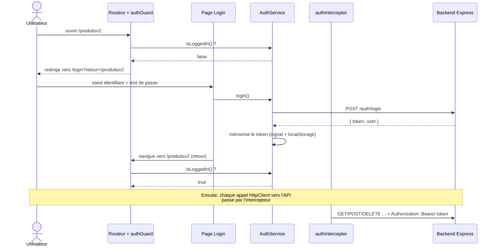

# Authentification par token JWT dans Angular

> **Prérequis** : avoir lu [07_Guards.md](07_Guards.md) et [12_HttpClient_Interceptors.md](12_HttpClient_Interceptors.md), connaître le projet (routes, `ProductService`, formulaires réactifs, signals).
> **Côté serveur** : ce document suppose que le backend a été modifié selon `backEnd/Express-API-REST/TUTO_AUTHENTIFICATION_JWT.md`. **Commencez par celui-ci** : il explique ce qu'est un JWT et ce que fait le serveur.
> **Objectif** : sécuriser la route `produitsv2` (`ProduitTable`) : seul un utilisateur connecté peut y accéder, et le token est envoyé automatiquement au backend.

---

## Sommaire

1. [Le principe côté Angular](#1-le-principe-côté-angular)
2. [Vue d'ensemble des fichiers](#2-vue-densemble-des-fichiers)
3. [Étape 1 — Les modèles (`model/IAuth.ts`)](#3-étape-1--les-modèles-modeliauthts)
4. [Étape 2 — Le service (`services/auth-service.ts`)](#4-étape-2--le-service-servicesauth-servicets)
5. [Étape 3 — L'intercepteur (`interceptors/auth-interceptor.ts`)](#5-étape-3--lintercepteur-interceptorsauth-interceptorts)
6. [Étape 4 — Le guard (`guards/auth-guard.ts`)](#6-étape-4--le-guard-guardsauth-guardts)
7. [Étape 5 — La page de connexion (`components/login`)](#7-étape-5--la-page-de-connexion-componentslogin)
8. [Étape 6 — Brancher dans `app.config.ts` et `app.routes.ts`](#8-étape-6--brancher-dans-appconfigts-et-approutests)
9. [Étape 7 — Connexion / déconnexion dans le header](#9-étape-7--connexion--déconnexion-dans-le-header)
10. [Tester pas à pas](#10-tester-pas-à-pas)
11. [Écrire les tests unitaires](#11-écrire-les-tests-unitaires)
12. [Erreurs fréquentes](#12-erreurs-fréquentes)
13. [Où stocker le token ? Limites et alternatives](#13-où-stocker-le-token--limites-et-alternatives)
14. [Pour aller plus loin](#14-pour-aller-plus-loin)

---

## 1. Le principe côté Angular



**Quatre responsabilités, quatre fichiers** — chacun a un seul rôle :

| Pièce | Question à laquelle elle répond |
|---|---|
| **AuthService** | « Qui est connecté ? Quel est son token ? » (et : se connecter / se déconnecter) |
| **authInterceptor** | « Comment prouver mon identité à l'API ? » → ajoute `Authorization: Bearer ...` à chaque requête |
| **authGuard** | « Cet utilisateur peut-il ouvrir cette page ? » |
| **Login** | « Comment l'utilisateur saisit-il ses identifiants ? » |

### Ce que le front ne peut PAS faire

Le guard bloque l'**affichage** d'une page. Mais tout le code Angular est téléchargé dans le navigateur : un utilisateur peut le modifier, ou ignorer complètement Angular et appeler l'API avec `curl`. **La vraie sécurité est donc toujours côté serveur** (le middleware `authenticateJWT`). Le front améliore l'expérience, le back protège les données.

> **Cas de `produitsv2`** : cette page utilise `MockProductService` (des données locales, sans appel réseau). Elle est protégée par le guard, mais comme elle ne parle pas à l'API, c'est ici l'interface qui est contrôlée. Les pages qui modifient réellement des données via l'API (`produitshttp` : création et suppression de produits) sont, elles, protégées par le backend : créer ou supprimer un produit sans token renvoie `401`.

---

## 2. Vue d'ensemble des fichiers

| Fichier | Action |
|---|---|
| `src/app/model/IAuth.ts` | **nouveau** : types |
| `src/app/services/auth-service.ts` | **nouveau** : login / logout / token |
| `src/app/interceptors/auth-interceptor.ts` | **nouveau** : ajoute le token aux requêtes |
| `src/app/guards/auth-guard.ts` | **nouveau** : protège les routes |
| `src/app/components/login/*` | **nouveau** : formulaire de connexion |
| `src/app/app.config.ts` | enregistre l'intercepteur |
| `src/app/app.routes.ts` | route `login` + `canActivate` sur `produitsv2` |
| `src/app/components/layout/header-v2/*` | boutons Connexion / Déconnexion |

---

## 3. Étape 1 — Les modèles (`model/IAuth.ts`)

On décrit la forme des données échangées avec l'API :

```typescript
export type Role = 'user' | 'admin';

export interface IPublicUser { id: string; username: string; role: Role; }

export interface ILoginRequest { username: string; password: string; }      // corps de POST /auth/login
export interface ILoginResponse { token: string; user: IPublicUser; }       // réponse

export interface IJwtPayload {                                              // contenu lisible du token
    sub: string; username: string; role: Role;
    iat: number; exp: number;   // en SECONDES depuis 1970
}
```

Ces types doivent **correspondre** à ce que renvoie le backend (`{ token, user }`). Un décalage ici donne des `undefined` difficiles à diagnostiquer.

---

## 4. Étape 2 — Le service (`services/auth-service.ts`)

C'est la **source de vérité** : tout le reste de l'application lui pose des questions.

### a) Le token est un signal

```typescript
private token = signal<string | null>(this.readStoredToken());
```

Le token est la seule donnée mémorisée. Le reste en est **déduit**.

### b) Persistance : `localStorage`

Sans persistance, un rechargement de page (F5) déconnecterait l'utilisateur, car la mémoire JavaScript est vidée. On enregistre donc le token dans `localStorage` à la connexion, on le supprime à la déconnexion, et on le relit au démarrage :

```typescript
private setToken(token: string | null): void {
    this.token.set(token);
    if (token) localStorage.setItem(TOKEN_STORAGE_KEY, token);
    else localStorage.removeItem(TOKEN_STORAGE_KEY);
}
```

> On compare la valeur lue au démarrage à la date d'expiration : un token périmé est **ignoré** plutôt que d'être considéré comme une connexion valide.

### c) Lire un token : `decodePayload`

Un JWT, c'est `header.payload.signature`. Le payload est du **Base64URL** : le décoder suffit pour le lire. Le client **ne peut pas** vérifier la signature (il n'a pas la clé secrète), il ne fait que **lire** :

```typescript
function decodePayload(token: string): IJwtPayload | null {
    try {
        const base64 = token.split('.')[1].replace(/-/g, '+').replace(/_/g, '/');
        const bytes = Uint8Array.from(atob(base64), (c) => c.charCodeAt(0));
        return JSON.parse(new TextDecoder().decode(bytes));
    } catch {
        return null;
    }
}
```

Trois détails :

1. `Base64URL` remplace `+` et `/` par `-` et `_` : on les remet avant d'appeler `atob`.
2. `atob` renvoie des caractères « octets » (Latin-1). Passer par `TextDecoder` permet de décoder correctement l'UTF-8 (un utilisateur nommé « Éloïse » s'afficherait mal sinon).
3. Si le token est malformé, `JSON.parse` ou `atob` lève une exception : on la rattrape et on renvoie `null`.

### d) L'expiration

Le payload contient `exp` (secondes). `Date.now()` est en **millisecondes** :

```typescript
function isExpired(token: string): boolean {
    const payload = decodePayload(token);
    return !payload || payload.exp * 1000 <= Date.now();
}
```

> Ce contrôle côté client sert uniquement à **éviter d'envoyer pour rien** un token périmé et à rediriger vers le login. Le serveur re-vérifie de toute façon à chaque requête : on ne lui fait jamais confiance au client.

### e) Les méthodes exposées

```typescript
currentUser = computed(...)      // utilisateur déduit du token (survit au F5)
isLoggedIn(): boolean            // token présent ET non expiré
getToken(): string | null        // pour l'intercepteur
login(credentials)               // POST /auth/login puis mémorise le token (opérateur tap)
logout()                         // efface le token
```

- **`login` renvoie un Observable** : le service n'y fait que `tap(...)` pour mémoriser le token, et c'est **le composant** qui s'abonne et décide quoi faire ensuite (rediriger, afficher une erreur).
- **`isLoggedIn()` est une méthode et non un `computed`**, parce qu'elle dépend aussi de l'heure (`Date.now()`), que les signals ne suivent pas. Elle lit néanmoins le signal `token()` : un template qui l'appelle est donc bien rafraîchi à chaque connexion/déconnexion.
- **`currentUser` est un `computed`** déduit du token : pas de deuxième source de vérité à synchroniser, et l'utilisateur est disponible dès le rechargement de la page.

---

## 5. Étape 3 — L'intercepteur (`interceptors/auth-interceptor.ts`)

```typescript
export const authInterceptor: HttpInterceptorFn = (req, next) => {
    const auth = inject(AuthService);
    const router = inject(Router);
    const token = auth.getToken();

    if (!token || !req.url.startsWith(API_URL)) {
        return next(req);                       // on ne touche à rien
    }

    const authReq = req.clone({ setHeaders: { Authorization: `Bearer ${token}` } });

    return next(authReq).pipe(
        catchError((error: unknown) => {
            if (error instanceof HttpErrorResponse && error.status === 401) {
                auth.logout();
                router.navigate(['/login'], { queryParams: { retour: router.url } });
            }
            return throwError(() => error);
        })
    );
};
```

Lecture ligne à ligne :

1. **Pas de token → on laisse passer** la requête telle quelle (ex. la requête de login, ou un visiteur non connecté qui lit la liste des produits).
2. **`!req.url.startsWith(API_URL)`** : on n'envoie le token **qu'à notre API**. Sans cette vérification, un appel `HttpClient` vers un site tiers lui transmettrait le token de l'utilisateur.
3. **`req.clone(...)`** : une requête est immuable, on en crée une copie portant l'en-tête.
4. **`catchError`** : si le serveur répond `401` alors qu'on avait envoyé un token (expiré, clé du serveur changée…), le token est inutilisable : on déconnecte et on renvoie au login, en retenant la page courante. **`throwError`** relance l'erreur pour que le code appelant puisse aussi réagir.

Aucun service existant (`ProductService`…) n'a été modifié : c'est tout l'intérêt de l'intercepteur.

---

## 6. Étape 4 — Le guard (`guards/auth-guard.ts`)

```typescript
export const authGuard: CanActivateFn = (route, state) => {
  const auth = inject(AuthService);
  const router = inject(Router);

  if (auth.isLoggedIn()) {
    return true;
  }
  return router.createUrlTree(['/login'], { queryParams: { retour: state.url } });
};
```

- **Connecté** → `true`, la navigation continue.
- **Non connecté** → on renvoie un **`UrlTree`** : le routeur redirige vers `/login`.
- **`state.url`** est l'URL qu'on essayait d'atteindre (`/produitsv2`). On la passe dans le paramètre `retour` pour revenir à la bonne page après connexion. Sans cela, l'utilisateur atterrirait toujours sur la même page par défaut.

Comparez avec le `preferenceGuard` existant : même mécanique, seul le critère change (couleur préférée → connexion).

---

## 7. Étape 5 — La page de connexion (`components/login`)

Un formulaire réactif classique (voir `ProductReactiveForm`) avec deux champs.

### Soumission

```typescript
onSubmit(): void {
    if (this.form.invalid) return;

    this.errorMessage.set('');
    this.loading.set(true);

    this.auth.login(this.form.getRawValue()).subscribe({
        next: () => {
            this.loading.set(false);
            const retour = this.route.snapshot.queryParamMap.get('retour');
            const safe = retour && retour.startsWith('/') && !retour.startsWith('//');
            this.router.navigateByUrl(safe ? retour : '/welcome');
        },
        error: (err) => {
            this.loading.set(false);
            this.errorMessage.set(err.status === 401
                ? 'Identifiants invalides.'
                : 'Le serveur est injoignable. Réessayez plus tard.');
        },
    });
}
```

- **`loading`** désactive le bouton pendant l'appel (évite le double envoi).
- **Retour à la page demandée** : on lit `?retour=` dans l'URL. On n'accepte qu'un **chemin interne** (`/...` mais pas `//...`) par prudence : une valeur contrôlée par un tiers ne doit pas pouvoir nous envoyer ailleurs.
- **Deux messages d'erreur** : `401` = mauvais identifiants ; autre erreur (réseau, serveur arrêté) = message différent. Sinon, un serveur éteint se confondrait avec un mauvais mot de passe.
- Dans le template, le champ mot de passe a `type="password"`, et les attributs `autocomplete="username"` / `"current-password"` permettent au navigateur de proposer son gestionnaire de mots de passe.
- Si l'utilisateur est **déjà connecté** et ouvre `/login`, le template affiche son nom et un bouton de déconnexion (bloc `@if (auth.isLoggedIn())`).

---

## 8. Étape 6 — Brancher dans `app.config.ts` et `app.routes.ts`

### `app.config.ts` : enregistrer l'intercepteur

```typescript
provideHttpClient(withInterceptors([authInterceptor]))
```

À la place du simple `provideHttpClient()` d'origine. **C'est l'étape qu'on oublie le plus souvent** : sans elle, l'intercepteur n'est jamais appelé.

### `app.routes.ts` : la route de login et la protection

```typescript
import { Login } from './components/login/login';
import { authGuard } from './guards/auth-guard';

{ path: 'produitsv2', component: ProduitTable, canActivate: [authGuard] },   // PROTÉGÉE
{ path: 'login', component: Login },                                          // publique
```

**Ordre des routes** : `login` doit être déclarée **avant** la route `**` (wildcard `NotFound`), qui capture tout ce qui n'a pas été reconnu plus haut.

Pour protéger une autre page, il suffit d'ajouter `canActivate: [authGuard]` sur sa route. Pour protéger tout un groupe de pages enfants, utilisez `canActivateChild` sur le parent.

---

## 9. Étape 7 — Connexion / déconnexion dans le header

Dans `header-v2.ts`, on injecte `AuthService` (`protected`, car le template le lit) et on ajoute :

```typescript
logout() {
  this.auth.logout();
  this.router.navigate(['welcome']);
}
```

Dans `header-v2.html`, on affiche l'un ou l'autre selon l'état :

```html
@if (auth.isLoggedIn()) {
    <span class="user">{{ auth.currentUser()?.username }}</span>
    <button matButton type="button" (click)="logout()">Déconnexion</button>
} @else {
    <a matButton routerLink="/login">Connexion</a>
}
```

Après la déconnexion, on **quitte la page** : sinon l'utilisateur resterait sur `produitsv2` alors qu'il n'y a plus accès (le guard ne s'exécute qu'à une navigation).

---

## 10. Tester pas à pas

1. **Backend** : dans `backEnd/Express-API-REST`, créer `.env` depuis `.env.example` (voir le tuto backend), puis `npm run dev`. Le serveur écoute sur `http://localhost:3000`.
2. **Front** : dans `angularProject/arnagular`, `npm start` → `http://localhost:4200`.
3. **Scénario 1 : accès refusé.** Allez sur `/produitsv2` sans être connecté → vous êtes redirigé vers `/login?retour=%2Fproduitsv2`.
4. **Scénario 2 : mauvais mot de passe.** Message « Identifiants invalides. »
5. **Scénario 3 : connexion.** `admin` / `admin123` → retour **automatique** sur `/produitsv2`. Le header affiche « admin » et « Déconnexion ».
6. **Scénario 4 : rechargement (F5).** Vous restez connecté.
7. **Scénario 5 : déconnexion.** Retour à l'accueil ; `/produitsv2` redirige de nouveau vers `/login`.
8. **Scénario 6 : le token voyage.** Connecté, ouvrez les outils de développement (F12) → onglet **Réseau**, supprimez un produit dans `produitshttp` : la requête `DELETE` porte l'en-tête `Authorization: Bearer eyJ...`. Déconnecté, la même action échoue (`401`).
9. **Scénario 7 : expiration.** Mettez `JWT_EXPIRES_IN=30s` côté backend, redémarrez, reconnectez-vous, attendez 30 secondes puis naviguez vers `/produitsv2` : redirection vers le login.

### Observer le stockage

F12 → **Application** → **Local Storage** → `http://localhost:4200` : la clé `auth.token` contient le JWT. Collez-le sur [jwt.io](https://jwt.io) pour lire son payload (n'utilisez jamais un vrai token de production).

---

## 11. Écrire les tests unitaires

Lancer les tests : `npm test` (Vitest). Trois fichiers ont été ajoutés :

| Fichier | Ce qu'il vérifie |
|---|---|
| `auth-service.spec.ts` | déconnecté par défaut ; `login` mémorise le token et déduit l'utilisateur (accents) ; `logout` ; token expiré ignoré |
| `auth-guard.spec.ts` | `true` si connecté ; sinon redirection vers `/login?retour=...` |
| `auth-interceptor.spec.ts` | en-tête ajouté vers l'API ; rien sans token ; **rien vers un autre serveur** ; `401` → déconnexion + redirection |

Techniques utilisées :

- **Faux `AuthService`** via `{ provide: AuthService, useValue: { ... } }` pour tester le guard et l'intercepteur **isolément**.
- **`TestBed.runInInjectionContext`** pour exécuter un guard fonctionnel (il appelle `inject()`).
- **`HttpTestingController`** : `expectOne(url)` retrouve la requête envoyée, `.flush(body, { status })` simule la réponse du serveur.
- **`vi.fn()`** (Vitest) pour espionner des appels (`logout`, `navigate`).
- Pour fabriquer un faux JWT : encoder soi-même `header.payload.signature` en Base64URL (la signature n'étant pas vérifiée côté client).

---

## 12. Erreurs fréquentes

| Symptôme | Cause probable |
|---|---|
| Le token n'est jamais envoyé (`401 Token manquant`) | `withInterceptors([authInterceptor])` oublié dans `app.config.ts` ; ou l'URL ne commence pas par `API_URL`. |
| Redirigé vers le login alors qu'on vient de se connecter | `login` n'a pas mémorisé le token : vérifier que la réponse du backend est bien `{ token, user }`. |
| Reconnecté à chaque F5 | le token n'est pas relu depuis `localStorage` au démarrage, ou il est expiré. |
| `/login` affiche la page « introuvable » | la route `login` est placée **après** la route `**`. |
| Erreur **CORS** dans la console | le backend doit appeler `app.use(cors())` avant ses routes. |
| `Network error` / « serveur injoignable » | le backend n'est pas démarré, ou le port diffère de `API_URL`. |
| `401` en boucle sur toutes les pages | le backend a redémarré avec un autre `JWT_SECRET` : déconnectez-vous puis reconnectez-vous. |
| Le nom affiché est vide après F5 | `currentUser` doit être déduit **du token** (`computed`), pas d'une variable remplie uniquement au login. |
| Le bouton Connexion/Déconnexion ne se met pas à jour | le template doit lire un signal (ici via `isLoggedIn()` qui lit `token()`) ; une propriété ordinaire modifiée ne rafraîchit pas la vue. |

---

## 13. Où stocker le token ? Limites et alternatives

Ce projet utilise `localStorage` : c'est simple et pédagogique, mais il faut connaître les compromis.

| Stockage | Avantage | Risque |
|---|---|---|
| **`localStorage`** (choix du projet) | simple, survit au F5 et à la fermeture du navigateur | lisible par **n'importe quel script de la page** : une faille **XSS** (injection de script) permet de voler le token |
| **Mémoire seule** (un signal) | non accessible depuis un autre onglet ni après coup | perdu au F5 |
| **Cookie `HttpOnly` + `Secure` + `SameSite`** | **illisible par JavaScript**, protège contre le vol par XSS | nécessite que le serveur dépose le cookie, et une protection **CSRF** |

Atténuations avec `localStorage` : durée de vie du token **courte**, ne jamais injecter de HTML non maîtrisé (Angular échappe le contenu par défaut : ne contournez pas ses protections avec `bypassSecurityTrust...`), et utiliser **HTTPS** en production.

---

## 14. Pour aller plus loin

- **Afficher / masquer selon le rôle** : `auth.currentUser()?.role === 'admin'` dans un `@if`. Ce n'est qu'un confort d'affichage, le serveur doit aussi vérifier (voir `requireRole` dans le tuto backend).
- **Guard par rôle** : un second guard (`adminGuard`) qui vérifie `currentUser()?.role`.
- **Page d'inscription** : appeler `POST /auth/register`, avec un validateur asynchrone sur le nom d'utilisateur (voir `nom-produit-unique-asyncvalidator.ts`).
- **Refresh token** : pour renouveler silencieusement une session sans redemander le mot de passe.
- **Variable d'environnement pour `API_URL`** (`environment.ts`) plutôt qu'une constante, afin de différencier développement et production (voir `10_mise_en_production.md`).
- **Lazy loading + `canMatch`** : empêcher même le téléchargement du code d'une page protégée.
